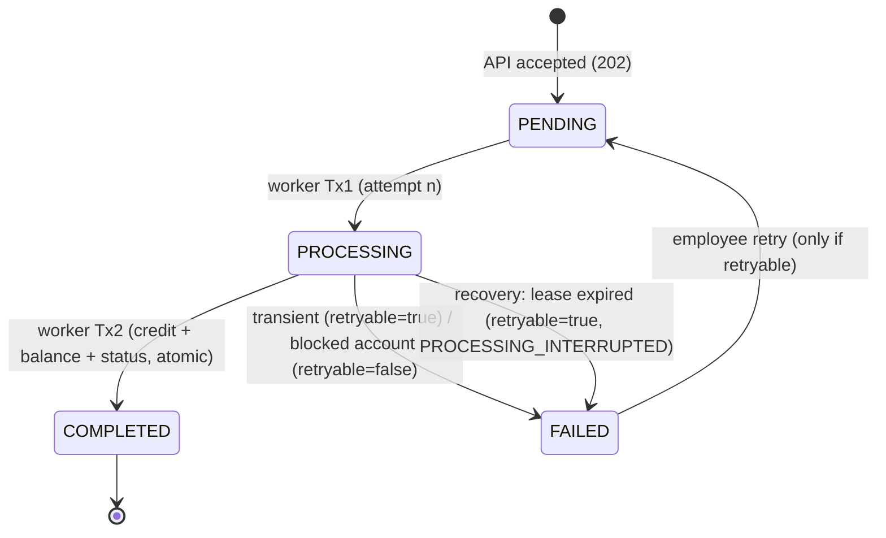

# Design: Deposit Control Center

This document explains how the system works, what it guarantees, and what it gives up. The full decision log with alternatives is in [decisions.md](../decisions.md).

## 1. Components and responsibilities

| Component | Responsibility | Never does |
|---|---|---|
| **frontend** (React + Ant Design, nginx) | Execution and investigation screens. Generates the Idempotency-Key. Polling | Business logic |
| **api** (FastAPI) | Validation, saving the request, idempotency, search and investigation, retry. **Outbox relay** to Kafka | **Never credits an account** |
| **Kafka** (`deposit-requests`) | An asynchronous, durable queue between receiving and processing | Isn't a source of truth for data |
| **worker** | Consumes from Kafka, processes the attempt, **credits atomically**. Recovery loop | Doesn't publish to Kafka directly |
| **PostgreSQL** | The source of truth: accounts, deposits, credits, events, outbox | |

One backend image runs as `migrate` / `api` / `worker` / `tests`, and only the command differs.

## 2. Flow

```mermaid
sequenceDiagram
    participant UI as UI (employee)
    participant API
    participant DB as PostgreSQL
    participant K as Kafka
    participant W as Worker

    UI->>API: POST /api/deposits (Idempotency-Key)
    API->>DB: TX: INSERT deposit(PENDING) ON CONFLICT DO NOTHING<br/>+ RECEIVED event + outbox row
    API-->>UI: 202 Accepted {deposit_id, PENDING} ("not credited yet")
    API->>K: relay: publish {deposit_id, dispatch_id} (key=account_id)
    API->>DB: outbox.published_at + PUBLISHED event (partition/offset)
    K->>W: message
    W->>DB: Tx1: lock deposit; PENDING→PROCESSING, attempts+1, ATTEMPT_STARTED
    Note over W: [demo delay] [demo transient failure → FAILED retryable]
    W->>DB: Tx2: lock deposit+account; INSERT credit;<br/>balance = balance + amount; COMPLETED; event
    W->>K: commit offset
    loop every 1s
        UI->>API: GET /api/deposits/{id}
    end
```

## 3. Status model



| Status | Meaning | Credited? |
|---|---|---|
| PENDING | Saved and waiting for processing | No |
| PROCESSING | An attempt started | **Not yet**, and it never implies a credit |
| COMPLETED | The credit and the result are saved | Yes, exactly once |
| FAILED | The attempt ended without a credit. `failure_retryable` separates transient from permanent | No |

`failure_code` values: `SIMULATED_TRANSIENT` (transient), `PROCESSING_INTERRUPTED` (transient), `ACCOUNT_BLOCKED` / `ACCOUNT_NOT_FOUND` / `BALANCE_LIMIT_EXCEEDED` (permanent).

## 4. Consistency between the balance, the credit and the status

**The invariant:** `status = COMPLETED  ⇔  a row exists in credits  ⇔  the balance was increased`.

It holds because all three are written in **one transaction (Tx2)**:

```
BEGIN
  SELECT … FROM deposits WHERE id=$1 FOR UPDATE      -- still my attempt? (status=PROCESSING, attempts=n)
  SELECT … FROM accounts WHERE id=$a FOR UPDATE      -- exists? not blocked? (checked under the lock)
  UPDATE accounts SET balance = balance + $amt RETURNING balance   -- atomic, no read-modify-write
  INSERT INTO credits (deposit_id UNIQUE, …, balance_after)
  UPDATE deposits SET status='COMPLETED', completed_at=…
  INSERT INTO deposit_events ('COMPLETED', …)
COMMIT
```

So:
- **No lost update:** two deposits to the same account are serialized on the account's row lock. The second sees the first's balance. The test runs 30 concurrent credits, and the result is exact.
- **No double credit:** four layers.
  1. `current_dispatch_id` (an old message is ignored).
  2. The status check under `FOR UPDATE` (only PENDING starts an attempt).
  3. A recheck in Tx2 that the attempt still owns the deposit.
  4. `UNIQUE(credits.deposit_id)` in the DB.
- **Verifiable at any time:** `balance = opening_balance + SUM(credits.amount)` (a query in the README).
- **The deposit's identity is fixed:** a DB trigger blocks any UPDATE of employee, account, amount or key. A retry continues the **same** deposit.

## 5. Recovery from interrupted processing

Each possible crash point and what happens:

| Where it stopped | Resulting state | How we recover | Credited? |
|---|---|---|---|
| API, before commit | Nothing was saved. The client gets no answer | The client resends with the **same key** → a new deposit (or a replay if it was saved) | No |
| API, after commit, before publishing | PENDING + an unpublished outbox row | The relay publishes every 2 seconds and on startup | No, until processing |
| Kafka down | PENDING, waiting in the outbox (`/health` = degraded) | The relay publishes once Kafka is back | No |
| Worker, after Tx1 (PROCESSING) and before Tx2 | PROCESSING with no credit | Kafka redelivers the message (no commit), and it's ignored because it's no longer PENDING. **The recovery loop:** PROCESSING longer than `PROCESSING_LEASE_SECONDS` (60) → FAILED `retryable=true` `PROCESSING_INTERRUPTED`. An employee retries | **No**, guaranteed by the invariant |
| Worker, after Tx2 and before the offset commit | COMPLETED | Redelivery → `DUPLICATE_IGNORED` | Yes, **once** |
| A slow attempt that went past its lease | Recovery already marked FAILED | Tx2 finds that the attempt no longer owns the deposit → `CREDIT_ABORTED`, no credit | No |
| DB down while the worker is processing | The transaction failed | No commit; `seek` back to the same message and retry with backoff | Depends on which transaction failed (see above) |
| A message lost / topic deleted | PENDING for a long time | **PENDING watchdog**: after 120 seconds, a new outbox row with the same dispatch → `REPUBLISHED` | No, until processing |

**PROCESSING never stays stuck:** within at most lease + interval (about 70 seconds) it becomes FAILED with a documented explanation, and the employee decides whether to retry. A recovery that auto-retried was rejected on purpose: the assignment describes retry as an attributed action by an employee.

The recovery update is **conditional** (`WHERE status='PROCESSING' AND processing_started_at < now() - lease`) with `FOR UPDATE SKIP LOCKED`, so it never collides with an attempt that's actually running.

## 6. Idempotency

- The client generates an `Idempotency-Key`. The UI generates a new key for every change to the form, and "resend" uses the same key.
- `UNIQUE(idempotency_key)` + `INSERT … ON CONFLICT DO NOTHING RETURNING id`: concurrent requests produce **exactly one row**, and the DB decides.
- `request_hash = sha256(employee|account|amount with 2 decimals)`: the same key with the same data gives 200 + the existing deposit. With different data it gives 409.
- **Scope:** global, with no TTL. **Trade-off:** keys are kept forever. In production: a TTL (for example 24–72 hours) plus archiving, or a per-client scope.
- A replay **doesn't** start a new attempt, even after a FAILED. A retry is always explicit (an endpoint with an employee identity).

## 7. Kafka

- **One topic, 3 partitions, key = account_id**: ordering per account, and up to 3 workers in parallel (`docker compose up --scale worker=3`).
- **At-least-once**: `enable_auto_commit=false`, commit after the DB work. The producer uses `acks=all` + `enable_idempotence`.
- **Transactional outbox**: the deposit and the message are written in one DB transaction. The relay publishes one row at a time (`FOR UPDATE SKIP LOCKED`, safe with multiple API replicas).
- **The message carries IDs only**: the DB is the source of truth. `schema_version` allows the message to evolve.
- **Poison message** (invalid JSON or an unknown deposit): logged and committed, so it doesn't block the partition.
- **The PUBLISHED timestamp is taken before sending**: the worker may consume the message before the relay commits, and the timeline still shows the right order (there's a regression test).

## 8. Observability and investigation

- `deposit_id` is the correlation ID across the API response (`X-Deposit-Id`), the Kafka key and headers, every table and every log line.
- **JSON** logs with `deposit_id`, `dispatch_id`, `attempt`, `partition`, `offset`, `status` and `error_code`: `docker compose logs api worker | grep <id>`.
- **The timeline** (`deposit_events`, append-only) includes every attempt, every failure with a code and an explanation, who requested a retry, duplicate messages that were ignored, the partition and offset of each message, and the processing worker.
- Event times come from a single clock (`clock_timestamp()` in the DB), so the order is reliable.

## 9. Security and scope (deliberate decisions)

- **Employee selection is a simulation** (the assignment): there's no authentication. In production: SSO/OIDC, with the employee taken from the token rather than the body.
- **Deposits only:** there's no debit and so no sufficient-funds check. Transfers would need double-entry, a sufficient-funds check, and locking accounts in a fixed order.
- `PATCH /accounts/{id}/status` exists for demos. In production it would need permissions and an audit.
- Containers run as non-root. No real secrets; local values have defaults in compose.

## 10. Trade-offs and what would change in production

| Here | Why it's fine here | In production |
|---|---|---|
| One Kafka broker, RF=1 | A local demo | 3+ brokers, RF=3, `min.insync.replicas=2` |
| Manual retry only | The assignment, plus control | Optionally an automatic retry with backoff for transient failures plus a DLQ, with a manual retry after N attempts |
| Lease-based recovery (60s) | Simple, safe thanks to the invariant | Heartbeat or fencing token, metrics and alerts on stuck items |
| Polling (1s/3s) | The assignment allows it | SSE/WebSocket, or push from a CDC stream |
| Idempotency keys with no TTL | Small scale | TTL plus archiving |
| A delayed partition holds up others in the same batch | A local demo | Separate per-partition processing, more partitions |
| SQL migrations with no versions | Idempotent and simple | Alembic/Flyway with versions |
| Relay inside the API | One less component | A separate relay or Debezium (CDC) |
